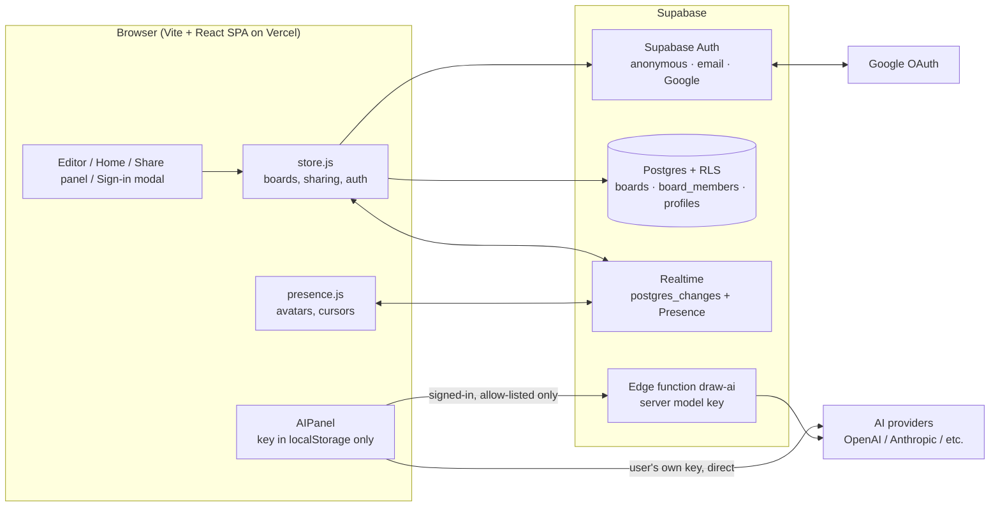
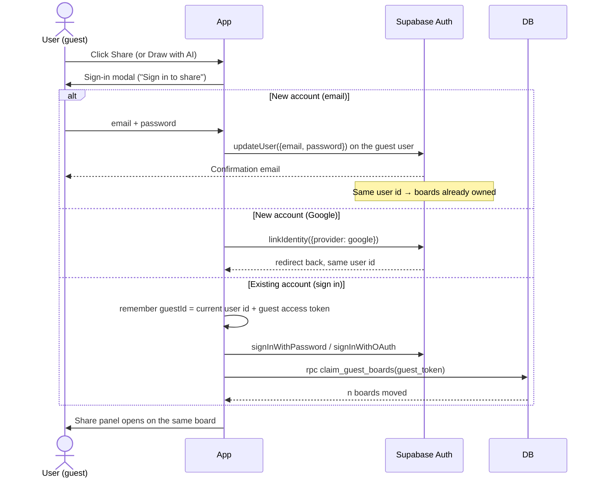
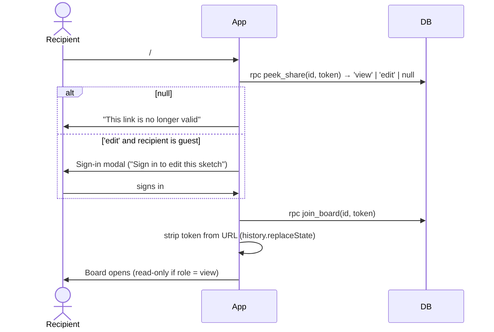
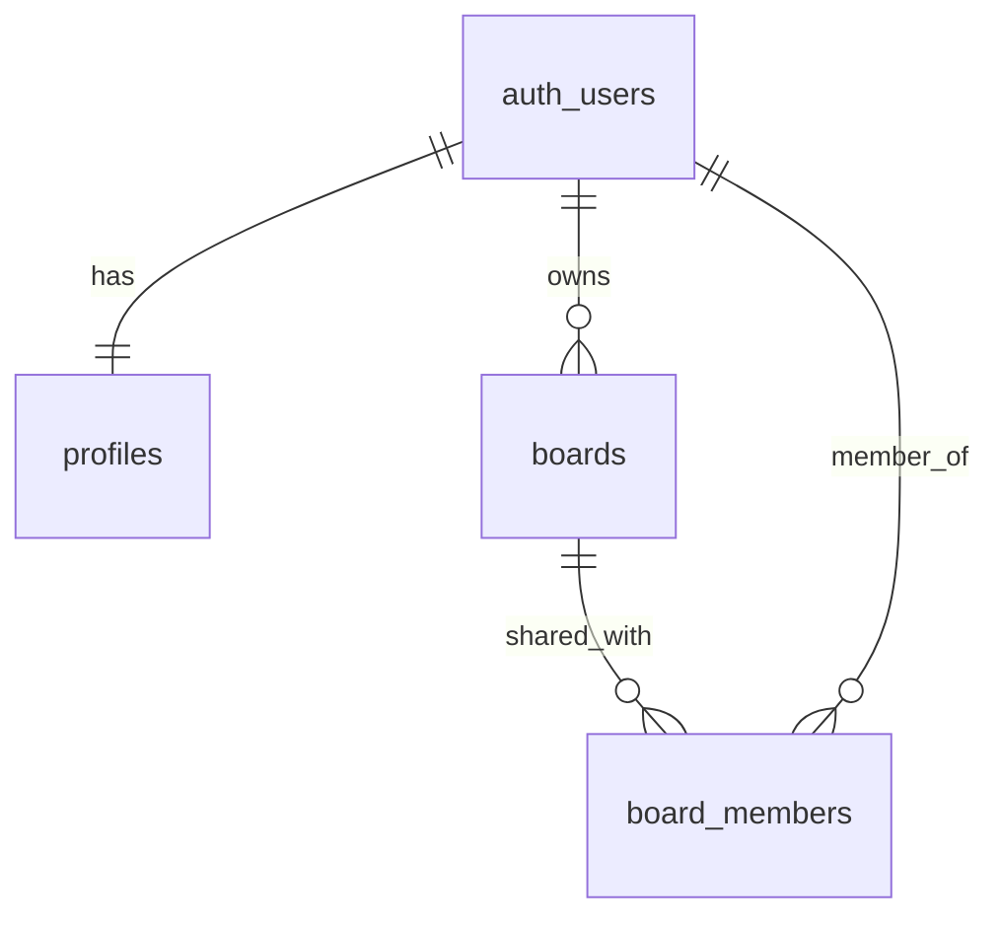

# HLD — Accounts, Share Links, Presence & AI Access

**Product:** Sketchpad (https://sketchpad-draw.vercel.app)
**Status:** Draft for review — nothing in this document is built until it is approved.
**Date:** 2026-11-16

---

## 1. Summary

Add real accounts (email + password, Google) on top of today's guest mode. Signing in becomes the gate for **sharing** and **Draw with AI**. A guest's boards move into their account the moment they sign in. Owners share a board with a **view link** or an **edit link**. Everyone on a board sees who else is there (avatars, cursors, selections). AI keys stay in each person's browser and never travel with a board or a link.

## 2. Goals and non-goals

**Goals**
- G1. Guests can open the app and draw instantly, with no sign-up wall.
- G2. Sign in / sign up with email + password or Google.
- G3. On sign-in, every board the guest created becomes owned by the account. No work is lost.
- G4. Only signed-in owners can share. Two link types: **Can view** and **Can edit**, each switchable on/off and revocable.
- G5. Read-only is enforced by the database, not just the UI.
- G6. Live presence: avatars, named cursors, selection outlines.
- G7. Draw with AI requires sign-in. Personal API keys are never stored on the server and never shared through a board or link.
- G8. The server-side model key (`draw-ai`) cannot be used to bill the app owner by strangers.

**Non-goals (later phases)**
- Invite by email, notifications, teams/workspaces.
- Per-shape conflict-free merging (CRDT). Version 1 keeps "last save wins" for the whole board.
- Comments, version history, custom avatars upload.

## 3. Decisions

| # | Decision | Choice in this design | Status |
|---|---|---|---|
| D1 | Who can share | Signed-in owners only | Agreed |
| D2 | Guest boards on sign-in | Move to account automatically | Agreed |
| D3 | Link types | Separate view link and edit link | Agreed |
| D4 | Sign-in to open a **view** link | Not required (shown as "Guest") | **Needs your OK** (recommended) |
| D5 | Sign-in to open an **edit** link | Required | **Needs your OK** (recommended) |
| D6 | AI | Requires sign-in; own key, browser-only | Agreed |
| D7 | Server model key (`draw-ai`) | (a) only the app owner's account | Agreed |
| D8 | Sync model | Whole board, last save wins, 4 s poll + realtime nudge (as today) | Proposed |

## 4. Architecture

**Key point:** the only secrets in the browser bundle are the Supabase URL and public (anon/publishable) key, as today. The Google client secret and the server model key live only in Supabase.

## 5. Components

| Component | Responsibility | New / changed |
|---|---|---|
| `store.js` | Board CRUD, share RPCs, auth helpers (`signInWithGoogle`, `signUp`, `signIn`, `signOut`, `upgradeGuest`, `claimGuestBoards`) | Changed |
| `auth.js` (new) | Session state hook `useAuth()`: `{ user, profile, isGuest }`, listens to `onAuthStateChange` | New |
| `SignInModal.jsx` | Google button, email form, sign up / sign in / reset, "why sign in" message per trigger (share / AI) | New |
| `AccountChip.jsx` | Top-right avatar menu: name, edit name, sign out; "Sign in" for guests | New |
| `SharePanel.jsx` | People with access (role picker, remove), view link row, edit link row | Extracted + changed |
| `presence.js` (new) | One Realtime channel per board: track self, broadcast cursor/selection, expose peers | New |
| `Editor.jsx` | Read-only mode for viewers, presence layer (cursors, outlines), gating Share/AI | Changed |
| `Home.jsx` | "My sketches" and "Shared with me" sections, role badges | Changed |
| `AIPanel.jsx` | Sign-in gate, per-user key storage, "use your own key" note on shared boards, hide server option unless allowed | Changed |
| `draw-ai` edge function | Reject anonymous callers; allow only allow-listed account (D7a) | Changed |
| Migrations | Tokens per role, member roles, profiles, RPCs, policies | New |

## 6. Identity and auth flows

### 6.1 Identity states

| State | How it happens | Can draw | Can share | Can use AI | Can open view link | Can open edit link |
|---|---|---|---|---|---|---|
| Guest | Automatic anonymous sign-in on first visit (today's behaviour) | Yes (own boards) | No | No | Yes | No → sign-in prompt |
| Signed in | Email or Google | Yes | Yes (own boards) | Yes (own key) | Yes | Yes |

### 6.2 Guest → account (boards carry over)

- **Upgrade in place** (`updateUser` / `linkIdentity`) keeps the user id, so nothing needs to move.
- **Sign in to an existing account** switches user id. Before switching, the client keeps the guest session's access token in memory. After sign-in it calls `claim_guest_boards`, which verifies that token server-side (edge function, using the token to read the guest's `sub` and confirm `is_anonymous = true`), then moves every board where `owner = guest_id` to the new user. The token is never stored on disk.
- **Sign out** clears the session and saved AI keys, then starts a fresh guest session.
- **Password reset** uses Supabase's reset email; redirect back to the app.

### 6.3 Opening a share link

## 7. Data model

Existing (live): `boards(id, owner, title, shapes jsonb, dark, created_at, updated_at, share_token)`, `board_members(board_id, user_id, joined_at)`. Migrations 003 and 004 are already applied to the database; their client code is not deployed.

### 7.1 Changes

**boards**
| Column | Type | Note |
|---|---|---|
| `share_token` | — | **Dropped** (replaced by the two below) |
| `view_token` | text unique null | Random 24-byte hex; null = view link off |
| `edit_token` | text unique null | Random 24-byte hex; null = edit link off |

Tokens are excluded from the column grants, so normal selects and realtime payloads to viewers never contain them. Only owner RPCs return them.

**board_members**
| Column | Type | Note |
|---|---|---|
| `board_id` | uuid → boards, cascade | PK part |
| `user_id` | uuid → auth.users, cascade | PK part |
| `role` | text check in ('view','edit') | **New**; set from the token used to join |
| `joined_at` | timestamptz | |

**profiles** (new)
| Column | Type | Note |
|---|---|---|
| `id` | uuid PK → auth.users, cascade | |
| `display_name` | text (1–40 chars) | From Google name, email prefix, or generated ("Swift Otter") for guests |
| `avatar_url` | text null | From Google only; https only |
| `color` | text | One of a fixed palette, picked at creation |
| `created_at`, `updated_at` | timestamptz | |

A trigger on `auth.users` insert/update creates or refreshes the profile.

**ai_usage** — only if D7 = (b): `(user_id, day date, count int, PK(user_id, day))`.

### 7.2 Entity diagram

## 8. Access control

### 8.1 Matrix (enforced by RLS + RPCs)

| Action | Owner | Editor (member, role=edit) | Viewer (member, role=view) | Anyone else |
|---|---|---|---|---|
| Read board | ✅ | ✅ | ✅ | ❌ |
| Update shapes / title | ✅ | ✅ | ❌ | ❌ |
| Delete board | ✅ | ❌ | ❌ | ❌ |
| Turn links on/off, read tokens | ✅ (signed-in, not guest) | ❌ | ❌ | ❌ |
| Change member role / remove member | ✅ | ❌ | ❌ | ❌ |
| Leave board | — | ✅ | ✅ | — |
| See profiles | Own + people on shared boards | same | same | Own only |

### 8.2 Policies

- `boards` select: `owner = auth.uid() or is_board_member(id)`.
- `boards` update: `owner = auth.uid() or board_role(id) = 'edit'`.
- `boards` delete / insert: owner only (insert sets owner = auth.uid()).
- Trigger `guard_board_update`: non-owners cannot change `owner`, `view_token`, `edit_token`.
- `board_members`: select own rows and rows of boards you own; delete own rows (leave) or as owner. No direct insert/update — only via RPCs.
- `profiles`: select if `id = auth.uid()` or the two users share a board (`shares_board_with(id)`); update own row only (name, color).
- Sharing RPCs check `(auth.jwt() ->> 'is_anonymous')::boolean is not true` so guests can't share even by calling the API.

### 8.3 RPC surface (all `security definer`, `search_path = public`, executable by `authenticated` only)

| Function | Who | Does |
|---|---|---|
| `enable_share(b, role) → text` | Owner, non-guest | Creates (or returns) the token for that role |
| `disable_share(b, role)` | Owner | Nulls that token. Existing members stay |
| `get_share(b) → {view, edit}` | Owner | Current tokens |
| `peek_share(b, token) → text` | Anyone signed in (incl. guest) | Returns the role the token grants, or null. No side effects |
| `join_board(b, token) → text` | View token: anyone; edit token: non-guest | Upserts membership with that role (never downgrades an existing editor) |
| `board_people(b) → setof {user_id, name, avatar, color, role}` | Owner or member | Owner first, then members |
| `set_member_role(b, user, role)` | Owner | Change view ↔ edit |
| `remove_member(b, user)` | Owner | Remove one person |
| `remove_all_members(b)` | Owner | Remove everyone |
| `claim_guest_boards(guest_token)` | Non-guest | Via edge function `claim-guest` (verifies token), moves boards |

`board_member_count` (migration 004) is replaced by `board_people`.

## 9. Realtime and presence

### 9.1 Board sync (as today, extended)
- Changes are saved whole-board, debounced 700 ms.
- Others pick them up through a `postgres_changes` UPDATE nudge plus a 4 s poll fallback, and only when the local user isn't mid-edit.
- Viewers receive updates but never save.

### 9.2 Presence channel — `presence:board:<id>`

| Message | Kind | Payload | Rate |
|---|---|---|---|
| Join / leave | Presence `track` | `{ userId, name, color, avatar, role }` | On connect |
| Cursor | Broadcast `cursor` | `{ userId, x, y }` in canvas coordinates | ≤ 20/s, throttled |
| Selection | Broadcast `select` | `{ userId, ids[] }` | On change |

- Nothing is written to the database.
- **Channel access:** use Realtime Authorization (private channels) with a policy on `realtime.messages` that allows only owners and members of the board. Otherwise anyone who guesses a board id could listen in.
- **UI:**
  - Top bar avatar stack, max 4 + "+N", coloured ring per user, name on hover.
  - Cursors: coloured arrow + name tag, hidden after 5 s idle.
  - Selection outlines dashed in that user's colour.
  - Your own avatar is first.

## 10. AI access and key handling

| Rule | How it's enforced |
|---|---|
| AI needs sign-in | AI button opens the sign-in modal for guests; viewers don't get the button |
| Keys never reach our servers | Keys only in `localStorage` under `sketchpad.ai.key.<userId>.<provider>`, sent directly from the browser to the provider. Never written to `boards`, `profiles`, presence or any request to Supabase |
| Keys don't leak between people on one computer | Key name includes the user id; sign-out deletes this user's keys |
| Share links don't pass keys | A link carries only board id + token. An editor on a shared board sees an empty key field and "Use your own API key. Keys are never shared through links." The owner may give their key to someone personally, outside the app |
| AI output | Ordinary shapes; synced to everyone on the board; billed only to whoever ran it |
| Server key (`draw-ai`) | D7(a): function reads the caller JWT, rejects anonymous users and anyone not on `ALLOWED_EMAILS` (a function secret). The "Supabase" provider is hidden in the UI for everyone else |

## 11. UI changes

- **Top bar:** `[Share]` (sign-in gate for guests) · presence avatar stack · account chip. Viewers see a "View only" badge instead of tools.
- **Sign-in modal:** title depends on trigger ("Sign in to share" / "Sign in to use AI" / "Sign in to edit"). Google button first, divider, email + password, switch sign up / sign in, "Forgot password". Same hand-drawn style and accent colour as the app.
- **Share panel:**
  - Header "Share sketch".
  - **People with access:** each row shows avatar, name, a role select (Owner, fixed / Can edit / Can view) and a ✕.
  - **Links:** two rows, "Anyone with the link · Can view" and "… · Can edit". Each has an on/off switch and a Copy button.
  - Footer: "Remove everyone".
- **Viewer mode:** tool rail, style panel, AI, align bar, keyboard edit shortcuts and text editing are all disabled. Pan and zoom still work, and export is allowed.
- **Home:** "My sketches" and "Shared with me" sections; each shared card shows Can view / Can edit and the owner's name.

## 12. Security

- **Secrets:**
  - Repo and bundle contain only the Supabase URL and publishable key (already in Vercel env vars, never committed).
  - Google client secret, server model key and `ALLOWED_EMAILS` live only in the Supabase dashboard and function secrets.
- **Auth settings:**
  - Redirect URLs allow-listed: `https://sketchpad-draw.vercel.app`, `http://localhost:5173`, `http://localhost:5174`.
  - Turn on: email confirmation, leaked-password protection, minimum password length 8.
- **Tokens:** 24 random bytes; never in normal selects; stripped from the URL immediately after joining. Turning a link off makes it useless at once.
- **Database:**
  - Read-only enforced in RLS (G5).
  - Every RPC checks the caller's role.
  - Guests are blocked from sharing and editing via the JWT `is_anonymous` claim.
- **Presence:** private channels with membership checks.
- **Rate limits:** join attempts per user (simple counter in `join_board`) to stop token guessing; Supabase auth rate limits on sign-up.
- **Review:** run the Supabase security advisor after each migration; fix all errors, document accepted warnings.

## 13. Migration and rollout

1. **Phase 0 — ship current work:**
   - Lock/align, live sync and the Share panel scaffolding go live.
   - The Share button stays hidden behind a flag until Phase 3.
2. **Phase 1 — database:**
   - Migration 005: view/edit tokens (drop `share_token`), member roles, profiles + trigger, new policies.
   - Replace 003's RPCs and 004's count with the RPCs in §8.3; add realtime channel policies.
   - Backfill a profile for every existing user.
   - No board data changes, so this is safe to run.
3. **Phase 2 — accounts:**
   - Google provider setup (manual, §15); `useAuth`, sign-in modal, account chip.
   - Guest upgrade + `claim-guest` edge function.
   - Sign-out key cleanup; AI sign-in gate; lock down `draw-ai`.
4. **Phase 3 — sharing:** Share panel with roles, link join flow with `peek_share`, viewer mode, Home sections.
5. **Phase 4 — presence:** channel, avatar stack, cursors, selection outlines.
6. **Phase 5 — verify and launch:** test plan §14, security advisor, deploy, smoke-test the live site.

Each phase is its own commit and deploy, so a problem can be rolled back without losing the rest.

## 14. Test plan

| Area | Case |
|---|---|
| Guest | Opens app, draws, refreshes — board persists |
| Upgrade | Guest draws 2 boards → signs up by email → both boards owned by the account |
| Upgrade | Guest → Google (link identity) → boards kept |
| Claim | Guest draws 1 board → signs in to an existing account → board moves; old guest owns nothing |
| Share gate | Guest clicks Share / AI → sign-in modal; RPC called directly as guest → rejected |
| View link | Recipient (guest) opens → read-only; direct API update → rejected by RLS |
| Edit link | Guest opens → must sign in → can edit; changes appear for owner within ~4 s |
| Roles | Owner switches editor → viewer; their next save fails and the UI switches to read-only |
| Revoke | Owner turns edit link off → link shows "no longer valid"; remove member → they lose access |
| Presence | Two browsers see each other's avatar, cursor and selection; non-member can't join the channel |
| AI | Signed-in user's key never appears in any request to Supabase or in board JSON; second account on a shared board sees an empty key field; `draw-ai` rejects non-allow-listed users |
| Security | Advisor clean (errors fixed); bundle grep finds no secrets |

## 15. Manual setup (owner does this; secrets never pass through chat or Git)

1. **Google Cloud Console:**
   - Create an OAuth client of type "Web application".
   - Authorised redirect URI: `https://amtljvwqghbazchnnzxe.supabase.co/auth/v1/callback`.
2. **Supabase → Auth → Providers → Google:** paste the Client ID and Client secret, and enable it.
3. **Supabase → Auth → URL configuration:** set the site URL and redirect URLs listed in §12.
4. **Supabase → Edge functions → Secrets:** set `ALLOWED_EMAILS` (your email) for `draw-ai`.
5. **Later, before real users:** custom email sender (e.g. Resend). The built-in sender allows only a few emails per hour.

## 16. Risks and mitigations

| Risk | Impact | Mitigation |
|---|---|---|
| Two editors change the board at once | One person's edit overwritten | Presence shows who's editing; poll skips while you're mid-edit; CRDT in a later phase |
| Built-in email rate limit | Sign-ups stall | Google sign-in as main path; custom SMTP before launch |
| Guest signs in on a shared computer | Boards claimed by the wrong account | Claim only runs right after an explicit sign-in from that guest session |
| Link forwarded beyond intended people | Unwanted access | View/edit separation, per-member removal, one-click link off |
| Board id guessing for presence | Eavesdropping on cursors | Private channels with membership policy |
| Server model key abuse | Unexpected bill | Allow-list only (D7a) |

## 17. Open questions for approval

1. **D4/D5:** View links open without sign-in; edit links require sign-in. OK?
2. ~~D7~~ — agreed: only the owner can use the server key.
3. Should viewers be allowed to **export** (PNG/SVG/JSON)? This doc assumes yes.
